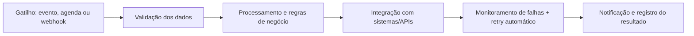

# 👋 Nicolas Pereira
### Engenheiro de Automação & Integração de Sistemas

**Elimino trabalho manual repetitivo e conecto sistemas que deveriam conversar entre si — mas não conversam.**

Ajudo empresas a parar de pagar por horas de trabalho braçal com dados, e a substituir gambiarras entre ferramentas por integrações que rodam sozinhas, 24h por dia.

 

---

## 💡 Por que empresas me contratam

Não vendo "horas de código". Vendo **tempo recuperado e decisões mais rápidas**.

- 🔁 Automatizo o que hoje consome horas do seu time todo mês
- 🔌 Conecto sistemas que "não tinham API" ou "não foram feitos pra isso"
- 🖥️ Desenvolvo sistemas ERP completos, front-end e back-end, com PHP e Adianti Framework
- 📄 Analiso a estrutura do banco de dados e construo relatórios sob medida para cada área da operação
- 📊 Transformo dados espalhados em painéis que qualquer gestor entende em segundos
- 🏗️ Construo por trás de tudo isso uma base sólida — não um MVP que quebra no primeiro imprevisto
- 🗣️ Falo a língua de negócio, não só a de código: entendo o processo antes de escrever a primeira linha

---

## 🎯 O que eu resolvo

| Problema | Solução | Stack |
|---|---|---|
| Horas perdidas todo mês em tarefas manuais repetitivas | Automação ponta a ponta, sem intervenção humana | n8n, APIs, Webhooks |
| Dados espalhados em vários sistemas/planilhas | Centralização + dashboards com dados confiáveis, atualizados sozinhos | SQL, MySQL, BI |
| Sistema legado que não conversa com as ferramentas novas | Camada de integração dedicada, com retry automático e monitoramento de falhas | Node.js, REST APIs |
| Empresa pagando por 5 ferramentas que fazem o trabalho de 1 | Sistema interno sob medida (CRM, dashboard, painel de controle) | Node.js, FastAPI, Adianti |
| Relatórios manuais, sem padrão, difíceis de manter | Relatórios sob medida direto no sistema, com dados validados no banco | PHP, Adianti, SQL |

---

## 🔧 Como uma automação minha funciona, na prática

Nada de "caixa-preta": toda automação sai documentada, testada e com um plano B para quando algo falhar — porque vai falhar, em algum momento, e o sistema precisa saber lidar com isso sozinho.

---

## 📈 Impacto real em projetos que já entreguei

**Automação de workflow**
> Time gastava ~40h/mês copiando dados manualmente entre dois sistemas. Construí uma automação em n8n integrada via API — o time recuperou esse tempo todo mês, sem margem de erro humano.

**Dashboard & BI**
> Dados de vendas espalhados em 3 planilhas diferentes, sem visão consolidada. Criei queries SQL otimizadas e um dashboard com atualização automática — decisão em minutos, não em horas de reunião conferindo números.

**Bridge legado ↔ moderno**
> ERP antigo, sem API própria, não conseguia se comunicar com as ferramentas SaaS da empresa. Desenvolvi uma camada de integração em Node.js com retry automático e monitoramento de falhas.

**ERP full-stack (projeto atual)**
> Desenvolvimento completo de um sistema ERP em PHP com Adianti Framework, do front-end ao back-end. Inclui análise da estrutura do banco de dados e a criação de uma quantidade grande de relatórios sob medida para diferentes áreas da operação.

---

## 🛠️ Stack

**Backend**

**Automação & Integrações**

**Dados & Infra**

---

## 📊 GitHub Stats

  
  

> Parte relevante do meu trabalho está em repositórios privados — lógica de negócio e integrações de clientes sob NDA. Posso apresentar detalhes em conversa, sob acordo de confidencialidade se necessário.

---

## 🧭 Como eu trabalho

- **Entrega incremental** — valor visível a cada etapa, não só no final do projeto
- **Documentação real** — Swagger, Postman, READMEs que alguém além de mim consegue usar
- **Testado antes de produção** — não só "funciona na minha máquina"
- **Arquitetura pensada pra crescer** — modular, sem gambiarra disfarçada de MVP
- **Segurança como padrão** — autenticação (JWT), queries otimizadas, dados protegidos

---

## 🤝 Formas de trabalharmos juntos

| Formato | Ideal para |
|---|---|
| **Diagnóstico inicial** | Você sabe que tem gargalo, mas não sabe onde nem como resolver |
| **Projeto pontual** | Escopo definido: uma automação, uma integração, um dashboard específico |
| **Parceria contínua** | Time técnico enxuto que precisa de reforço recorrente em automação/integrações |

---

## 📬 Vamos conversar?

Tem um processo manual consumindo tempo do seu time? Sistemas que não se falam? Precisa de algo sob medida em vez de mais uma assinatura mensal?

**Me conta o problema — eu te digo se e como resolvo.**

[📧 trabalhonicolasplg@gmail.com](mailto:trabalhonicolasplg@gmail.com) · [💼 LinkedIn](https://www.linkedin.com/in/n%C3%ADcolas-pereira-lucas-gon%C3%A7alves-4466b5326/) · [💻 GitHub](https://github.com/Nicolasplgn)

