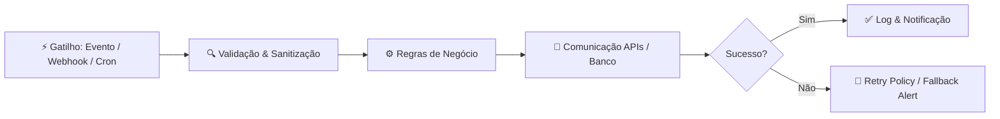

  

  

  
  

  
  
  

---

## 💡 Por que empresas me contratam?

Não entrego apenas código; entrego **processos blindados, tempo recuperado e redução de custos operacionais**.

- 🔁 **Zero Trabalho Braçal:** Automatizo rotinas críticas que hoje custam dezenas de horas mensais da sua equipe.
- 🔌 **Integrações Sem Fronteiras:** Conecto sistemas modernos (SaaS/APIs) a bases legadas sem documentação ou APIs nativas.
- 🖥️ **Sistemas & ERPs Sob Medida:** Desenvolvimento full-stack com **PHP & Adianti Framework**, unindo agilidade e robustez corporativa.
- 📊 **Engenharia de Dados & BI:** Estruturação de queries SQL de alta performance e painéis analíticos para tomadas de decisão imediatas.
- 🛡️ **Tolerância a Falhas:** Automações desenhadas com retentativas automáticas, logs de auditoria e fallback estruturado.

---

## 🎯 Problemas de Negócio que Eu Resolvo

| Cenário de Dor Comum | Solução Implementada | Stack Principal |
| :--- | :--- | :--- |
| **Horas perdidas em tarefas manuais repetitivas** | Automação ponta a ponta sem intervenção humana | `n8n` · `Webhooks` · `APIs` |
| **Sistemas legados isolados das ferramentas novas** | Camada de integração (Bridge API) com retry e alertas | `Node.js` · `TypeScript` · `REST` |
| **Gargalo em geração de relatórios e dados dispersos** | Consultas SQL otimizadas e dashboards automatizados | `MySQL` · `SQL` · `FastAPI` |
| **Empresa refém de múltiplos SaaS caros** | Sistema/ERP interno sob medida para a operação | `PHP` · `Adianti Framework` · `Docker` |

---

## 🔧 Padrão de Engenharia de Integração

Toda integração é desenvolvida com arquitetura resiliente para garantir disponibilidade contínua:

---

## 📈 Impacto Real em Projetos Entregues

**⚡ Automação de Workflow**
Equipe gastava ~40h/mês copiando dados manualmente entre ferramentas distintas. Criei um fluxo 100% automatizado em n8n integrado via API — tempo economizado: 100%, com margem de erro zerada.

**🌉 Bridge Legado ↔ Moderno**
ERP antigo e fechado, sem API própria, sem comunicação com as ferramentas modernas da empresa. Desenvolvi um microsserviço intermediário em Node.js com filas de retry e monitoramento de falhas.

**📊 Centralização de Dados & BI**
Decisões operacionais travadas por relatórios espalhados em múltiplas planilhas. Estruturei queries SQL de alta performance e um dashboard com dados sincronizados em tempo real.

**🏢 ERP Corporativo Full-Stack (Projeto Atual)**
Desenvolvimento de ponta a ponta de um sistema ERP completo em PHP com Adianti Framework, incluindo modelagem de banco de dados e relatórios sob medida para cada área da empresa.

---

## 🛠️ Stack Tecnológica

**Backend & APIs**

    

**Automação & Integrações**

   

**Bancos de Dados & Infra**

   

---

## 📊 Estatísticas do GitHub

  
  

🔒 **Nota:** Parte relevante da minha produção técnica envolve regras de negócio e integrações proprietárias sob sigilo contratual (NDA).

---

## 🧭 Como Eu Trabalho

- **Entrega Contínua e Transparente:** Progresso validado a cada etapa, sem surpresas no final.
- **Documentação Real:** Contratos de API limpos, endpoints catalogados (Swagger/Postman) e código autoexplicativo.
- **Segurança por Padrão:** Autenticação via JWT/OAuth, sanitização estrita de inputs e proteção de credenciais.
- **Código Modular:** Arquitetura limpa para suportar aumento de volume sem necessidade de retrabalho.

---

## 🤝 Modelos de Atuação

| Formato | Ideal para |
| :--- | :--- |
| **1. Diagnóstico Inicial** | Identificar gargalos, fluxos manuais e desenhar o plano de integração. |
| **2. Projeto Pontual** | Escopo fechado para uma automação, dashboard ou API específica. |
| **3. Parceria Contínua** | Apoio recorrente como braço técnico especializado em integrações e backend. |

---

## 📬 Vamos destravar seus processos?

Se sua empresa tem rotinas repetitivas que tomam tempo da equipe ou ferramentas que deveriam trabalhar sincronizadas, entre em contato:

  
  

  

